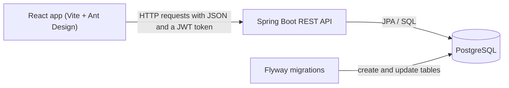

# Architecture Overview

Task Manager API 2.0 has three main parts that talk to each other.

## The three parts

1. **Frontend (React):** what the user sees in the browser. It shows pages and sends requests to the backend.
2. **Backend (Spring Boot):** the REST API. It checks who the user is, applies the rules, and reads and writes data.
3. **Database (PostgreSQL):** stores users, projects, tasks, and comments permanently. Flyway creates the tables through versioned migration files.

## Layers inside the backend

| Layer | Job |
|---|---|
| Controller | Receives HTTP requests and returns responses. Kept thin. |
| Service | Holds the business rules and permission checks. |
| Repository | Talks to the database. |
| Entity | A Java class that maps to a database table. |
| DTO | A small class that shapes the data sent in and out of the API. |

## Environments

- **Local development:** Java, Maven, and Node run on the developer's machine, and PostgreSQL runs in Docker.
- **Later:** Docker Compose runs everything together, GitHub Actions tests every push, and the app is deployed online.