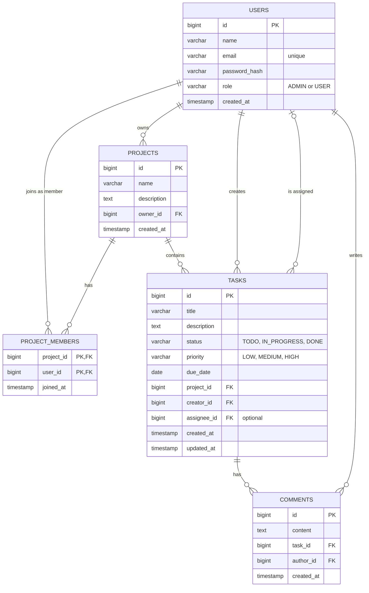

# Database Design

## Relationships in plain words

- One user can own many projects.
- A project has many members, and a user can be a member of many projects. The `project_members` table connects them.
- A project contains many tasks, and every task belongs to exactly one project.
- Every task has a creator. It may also have an assignee, who can be empty.
- A task has many comments, and each comment has one author.